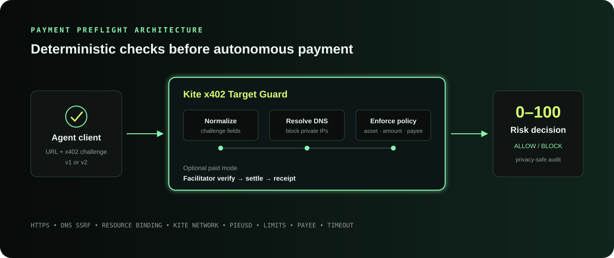
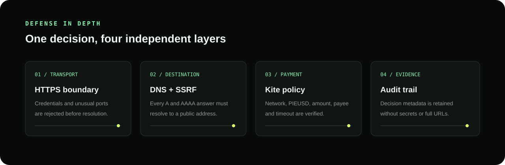

# Architecture

Target Guard is a small policy boundary between an agent and an unfamiliar
x402 service. It deliberately does not proxy the target request: the client
retains custody of credentials and decides whether to proceed after receiving
the evaluation.



```text
Agent / browser
      │ URL + PAYMENT-REQUIRED
      ▼
┌──────────────────────────────┐
│ Target Guard HTTP service    │
│  1. Parse x402 v1/v2         │
│  2. Resolve target DNS       │
│  3. Apply URL/network policy │
│  4. Verify payment fields    │
│  5. Return decision + audit  │
└──────────────────────────────┘
      │ optional service payment
      ▼
Kite facilitator verify/settle
```

## Security boundaries



- DNS answers are evaluated but not pinned. The eventual HTTP client must
  resolve again safely and bind the connection to the approved address.
- The audit ring buffer is process-local and only retains hostname, decision,
  score, finding codes, network, amount and settlement hash.
- The browser console inserts all server values with `textContent`; challenge
  data is never rendered as HTML.
- Paid mode verifies and settles the authorization before running evaluation.
  Operators should price this service as a low-cost preflight check.

## Decision lifecycle

1. Validate and normalize the request and x402 challenge.
2. Enforce URL syntax, HTTPS, credentials, hostname and port rules.
3. Resolve every A/AAAA answer and reject if any answer is non-public.
4. Choose a Kite offer and validate its scheme, network, asset, amount, payee,
   timeout and exact resource binding.
5. Score each blocking finding at 40 and each warning at 10, capped at 100.
6. Return the decision and append a privacy-safe audit entry.
